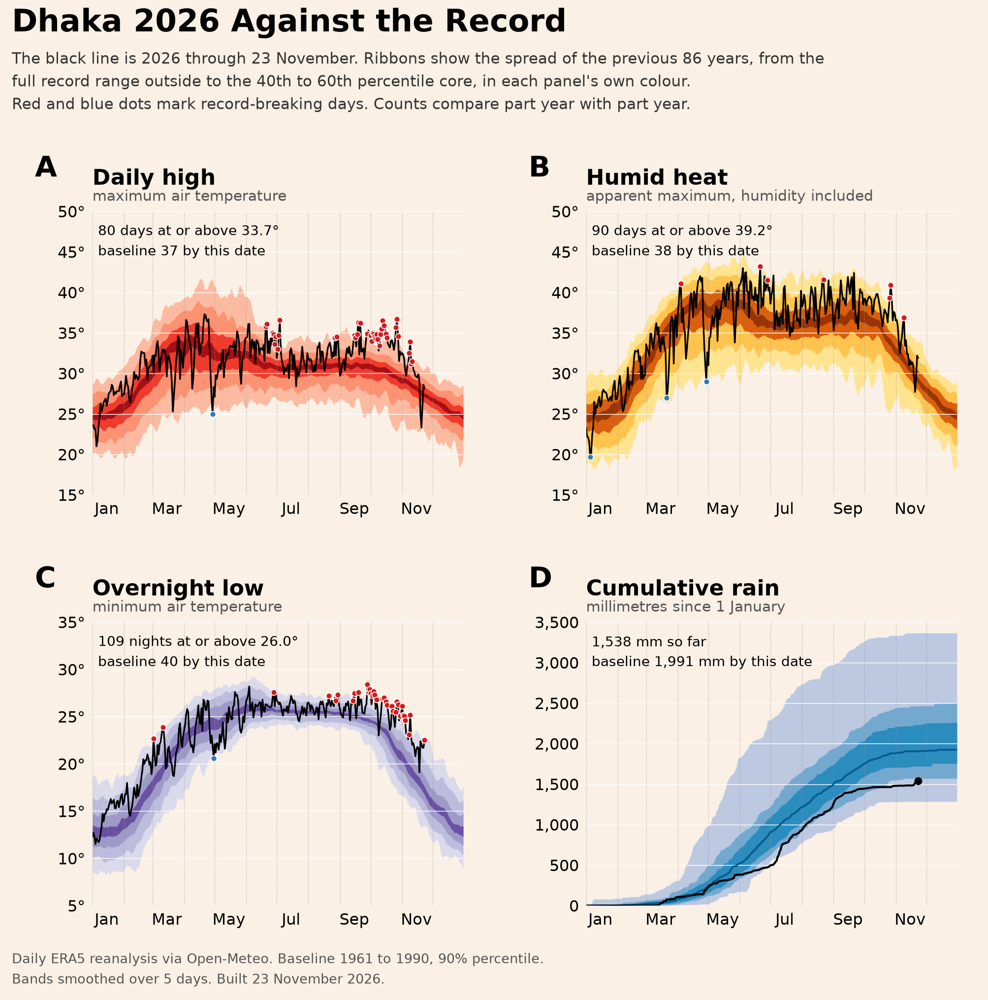

# Dhaka Weather

Automated climate graphs for Dhaka, Bangladesh, built in Python with matplotlib
and refreshed daily by GitHub Actions.

By [Mozammel Hoque](https://github.com/mozammel47). MIT licensed, see
[Licence](#licence).

**Why this exists.** A phone already tells you whether to carry an umbrella. What
it never tells you is where today sits against the eighty-odd years behind it, or
whether Dhaka is becoming a different place to live in. Every panel here puts the
current year against the full record since 1940, and carries a count comparing
this year with the 1961 to 1990 baseline by the same calendar date.

The daily refresh is not the point, but it does mean the black line always runs
up to yesterday.

## The year against the record



Four panels, all on a day-of-year axis, all in the idiom of the parent
repository. The black line is the current year. Behind it, nested ribbons give
the distribution of that variable for every calendar day across the whole record,
from the full range on the outside to the 40th to 60th percentile core. Red and
blue dots mark days that broke the all-time record for that calendar day.

| Panel | Variable | Ramp |
| --- | --- | --- |
| A, daily high | maximum air temperature | reds |
| B, humid heat | apparent maximum, humidity included | yellow through brown |
| C, overnight low | minimum air temperature | purples |
| D, cumulative rain | running total since 1 January | blues |

The four were chosen so that no two say the same thing.

**Why apparent temperature gets a panel.** In a delta city the humid heat is the
story and the dry-bulb reading hides it. Open-Meteo serves apparent temperature
directly, so humidity is in the picture rather than ignored.

**Why the night panel.** Warm nights track heat mortality more closely than
daytime peaks, since a hot day is survivable if the night lets the body shed
heat. Overnight minima also tend to rise faster than daytime maxima under
warming, so a drift upward usually shows here first.

**Why cumulative rain rather than daily bars.** Dhaka receives most of its rain
in a few monsoon months, so a running total carries far more than a picket fence
of daily values.

### The counts in the corner of each panel

A day-of-year axis shows where this year sits. It cannot show whether the whole
distribution has moved, so each panel carries that in words instead, as a count
of qualifying days this year against the 1961 to 1990 average by the same date.

Two things make those counts honest.

- **The threshold comes from Dhaka, not from a textbook.** It is the 90th
  percentile of Dhaka's own baseline record, recomputed every run and printed on
  the figure, never a hidden constant. This matters more than it sounds. The
  European "tropical night" threshold of 20 °C is meaningless here, because
  nearly every Dhaka summer night clears it. Asking how often today's weather
  would have counted as unusual within living memory is the question that
  travels.
- **Part year is compared with part year.** The baseline figure counts only days
  up to the same calendar date. Comparing eleven months of this year against full
  baseline years would flatter the past by construction.

### The yearly table

`src/indicators.py` holds no plotting code. It writes `data/indicators.csv`, one
row per year, with hot nights, humid heat days, annual rainfall, rainfall
concentration and monsoon onset, withdrawal and length. Nothing in the figures
uses the monsoon columns, but they are there if you want to model or plot them
separately.

Monsoon dates carry a caveat. There is no single agreed definition of onset, and
the Bangladesh Meteorological Department, the India Meteorological Department and
the research literature all use different criteria. The rule applied here lives
in the constants at the top of `src/indicators.py`. Onset is the first day from
1 May onward where that day plus the next six bring at least 40 mm and that day
plus the next nineteen bring at least 100 mm, the second condition being what
stops an isolated pre-monsoon thunderstorm from being read as the monsoon
arriving. Withdrawal is the day before the first fortnight from 1 September
onward that brings less than 20 mm. If you compare against a published onset
series, expect offsets of a week or more, and say which definition you used.

## The standalone graphs

The same three charts the four-panel figure draws at panel size, each on its own
full-width canvas with the percentile key spelled out and the record dates in the
caption. Use these when one variable is the point, and the four-panel figure when
you want the whole year at once.


*All four images fill in after the first fetch-and-build run, whether you run it
locally or trigger the workflow from the Actions tab.*

These are a Python port of [jdjohn215/milwaukee-weather](https://github.com/jdjohn215/milwaukee-weather),
adapted for a monsoon climate. The original uses R, ggplot2 and NOAA's GHCN-Daily
station records. The graphic itself is much older than either repository, and the
lineage is set out under
[Where this graphic comes from](#where-this-graphic-comes-from) below.

Each graph carries its own colour ramp so the three are told apart instantly,
warm reds for daytime heat, purples for the night, blues for rain.

**Daily high temperature.** Nested ribbons give the distribution of the daily
maximum temperature for every calendar day across the whole record, from the
all-time range down to the 40th to 60th percentile core. The black line is the
current year. Red and blue dots mark days where the current year broke the
all-time record for that calendar day, judged against the unsmoothed daily
extremes. In Dhaka this curve peaks in April, before the monsoon arrives, not at
midsummer.

**Overnight low temperature.** The same picture drawn from the daily minimum.
This is the quieter half of the temperature story and often the more
consequential one, since a hot day is survivable if the night lets the body shed
heat. Warm nights track heat mortality more closely than daytime peaks do, and
overnight minima tend to rise faster than daytime maxima under warming, so a
drift upward usually shows here first.

**Cumulative rainfall.** Dhaka receives most of its rain in a few monsoon months,
so a running annual total says far more than daily bars. Bands cover the full
historical range plus the 10th to 90th and 25th to 75th percentiles. The wettest
and driest years on record are traced as dashed lines, and the current year is
labelled against the median for the same date.

## Where this graphic comes from

This design has a long pedigree and it is worth stating plainly, since the
version here is four steps removed from the original.

1. **The New York Times, 11 January 1981, page 32.** The paper's graphics desk
   published "New York City's Weather for 1980", a single hand-drawn panel
   carrying roughly 2,200 numbers across temperature, precipitation and humidity,
   with the year's daily values set against the long-run normal.
2. **Edward Tufte, 1983.** He reproduced it on page 30 of *The Visual Display of
   Quantitative Information* as an example of a newspaper graphic that chooses
   detail over simplicity and succeeds. That reproduction is why the chart is
   widely known as a Tufte graphic. He later drew his own version,
   [New York City's Weather in 2003](https://www.edwardtufte.com/bboard/q-and-a-fetch-msg?msg_id=00014g).
3. **Brad Boehmke, 2014.** He rebuilt the chart in R for Dayton, Ohio, adding the
   percentile ribbons and the record-breaking day markers that this repository
   uses. [Alex Bresler](https://gist.github.com/abresler/46c36c1a88c849b94b07)
   adapted that code for New York City, and between them the R recipe spread
   widely.
4. **John D. Johnson, [jdjohn215/milwaukee-weather](https://github.com/jdjohn215/milwaukee-weather).**
   He wrapped the chart in a GitHub Actions workflow that refetches NOAA data and
   rebuilds the graphs every day. That automation pattern is what this repository
   ports to Python.

So the picture belongs to the NYT graphics desk and to Tufte, the percentile-band
and record-marker treatment to Boehmke, the daily automation to Johnson, and only
the Python, the ERA5 pipeline and the Dhaka framing are new here.

## About the data

[Open-Meteo](https://open-meteo.com/) serves ECMWF ERA5 and ERA5-Land reanalysis
as a free API with no key required. Two endpoints are used together.

| Endpoint | Role |
| --- | --- |
| `archive-api.open-meteo.com/v1/archive` | daily values from 1940 to roughly five days ago |
| `api.open-meteo.com/v1/forecast` with `past_days` | patches the reanalysis lag so the series runs to yesterday |

Variables pulled are `temperature_2m_max`, `temperature_2m_min`,
`precipitation_sum` and `apparent_temperature_max`, all in metric units, with the
day boundary set to `Asia/Dhaka`. If you have a cached CSV from before the
apparent-temperature column existed, the fetch script notices the missing column
and refetches the whole record rather than leaving a gap.

Reanalysis is a model-plus-observations product rather than a gauge reading at a
single point. For Dhaka that is a feature, since the local gauge record in
GHCN-Daily is patchy. If you want the station record instead, see the note on
swapping sources below.

**Citation.** Hersbach, H. et al. (2020), The ERA5 global reanalysis.
*Quarterly Journal of the Royal Meteorological Society*, 146, 1999 to 2049.
Open-Meteo asks that you credit them and link back when you publish a graph.

## Running it yourself

```bash
pip install -r requirements.txt

python src/fetch_dhaka.py                 # writes data/dhaka_daily.csv
python src/indicators.py                  # writes data/indicators.csv
python src/build_year_panels.py           # writes graphs/YearAgainstRecord_Dhaka.png
python src/build_daily_high.py            # writes graphs/DailyHighTemp_Dhaka.png
python src/build_overnight_low.py         # writes graphs/OvernightLowTemp_Dhaka.png
python src/build_cumulative_precip.py     # writes graphs/CumulativeRainfall_Dhaka.png
```

`src/indicators.py` also prints one line of plain arithmetic comparing the last
ten complete years against the first ten on record, which is the sentence worth
putting at the top of the README once you have real data in hand.

The first fetch pulls the whole record from 1940 in twenty-year chunks and takes
a minute or two. Later runs refetch only a trailing window and merge, because
ERA5 revises its most recent days as the reanalysis settles. Pass `--full` to
force a complete refetch.

Useful flags.

```bash
python src/build_daily_high.py --smooth 1        # raw daily percentiles, no smoothing
python src/build_daily_high.py --smooth 11       # heavier smoothing of the ribbons
python src/build_daily_high.py --palette night   # any chart in any of the three ramps
python src/build_daily_high.py --data path.csv --out somewhere.png
```

### No network access

`tools/make_sample_data.py` writes a synthetic Dhaka-like series so the plotting
code can be exercised offline. It is not real weather data.

```bash
python tools/make_sample_data.py --out data/sample_dhaka_daily.csv
python src/build_daily_high.py --data data/sample_dhaka_daily.csv --out graphs/_preview.png
```

## Automatic updating

`.github/workflows/update-graphs.yml` runs every day at 02:15 UTC, which is 08:15
in Dhaka. It refetches the data, rebuilds both graphs and commits the result back
to the repository. You can also trigger it by hand from the Actions tab.

Two settings matter on a fresh fork. Under Settings, Actions, General, set
workflow permissions to read and write, otherwise the commit step cannot push.
And GitHub disables scheduled workflows on repositories with no activity for
sixty days, so a run by hand wakes it up again.

## Adapting this to another city

Everything location-specific sits at the top of `src/fetch_dhaka.py`.

```python
LATITUDE = 23.8103
LONGITUDE = 90.4125
TIMEZONE = "Asia/Dhaka"
LOCATION_NAME = "Dhaka"
```

Change those four values, update the `title` passed by each build script, and the
rest follows. The rainfall y-axis step switches between 250 mm and 500 mm on its
own depending on how wet the place is.

To use a NOAA GHCN-Daily station instead, find the station code in
[ghcnd-stations.txt](https://www1.ncdc.noaa.gov/pub/data/ghcn/daily/ghcnd-stations.txt)
and read `https://www.ncei.noaa.gov/pub/data/ghcn/daily/by_station/<CODE>.csv.gz`
into the same column layout that `src/fetch_dhaka.py` writes, which is
`date, year, month, day, day_of_year, tmax_c, tmin_c, app_tmax_c, prcp_mm`. GHCN
values arrive in tenths of a degree Celsius and tenths of a millimetre, so divide
both by ten. The Dhaka station code is `BGM00041923`.

One thing does not survive that swap. GHCN-Daily carries no apparent temperature,
so panel B would have to fall back to dry-bulb maxima, which for a delta city
loses the part of the heat signal that actually harms people. Everything else
works unchanged.

## Figure settings and colour

`src/style.py` holds the shared matplotlib configuration. Output is 300 dpi on a
170 mm canvas, Arial with TrueType font embedding (`pdf.fonttype` and
`ps.fonttype` set to 42), saved without `bbox_inches="tight"` so the declared
canvas size is exact. Change the canvas in one place and all three graphs follow.

The same file holds the four palettes, each a ColorBrewer sequential ramp of four
steps running light to dark.

| Name | Ramp | Used by |
| --- | --- | --- |
| `heat` | reds | daily high temperature, panel A |
| `humid` | yellow through brown | apparent maximum, panel B |
| `night` | purples | overnight low temperature, panel C |
| `rain` | blues | cumulative rainfall, panel D |
| `burst` | greens | spare, reachable through `--palette` |

Humid heat is deliberately yellow through brown rather than a second red, since
it sits next to the daytime heat panel and the two must not be confused.

Sequential ramps were chosen over arbitrary colours for two reasons. They survive
being printed in greyscale, since each step differs in lightness as well as hue,
and they stay readable under the common forms of colour vision deficiency. The
lightest step in each ramp is kept deliberately darker than the linen paper, so
the outermost record-range band does not vanish into the background. Every
standalone build script takes `--palette`, so any of those charts can be drawn in
any of the five.

The four-panel figure uses `apply_panel_style()` rather than the single-chart
style, with slightly smaller tick and title type, since four panels on one
170 mm canvas crowd at full publication size.

## Layout

```
.
├── src/
│   ├── style.py                      canvas, fonts and the five palettes
│   ├── fetch_dhaka.py                data retrieval and incremental caching
│   ├── indicators.py                 yearly metrics, thresholds, no plotting
│   ├── ribbon.py                     percentile ribbons, draws onto any axis
│   ├── cumulative.py                 rainfall envelope, draws onto any axis
│   ├── build_year_panels.py          four-panel year figure
│   ├── build_daily_high.py           daily high temperature graph
│   ├── build_overnight_low.py        overnight low temperature graph
│   └── build_cumulative_precip.py    cumulative rainfall graph
├── tools/
│   └── make_sample_data.py           synthetic series for offline testing
├── data/                             dhaka_daily.csv and indicators.csv
├── graphs/                           generated PNGs
└── .github/workflows/
    └── update-graphs.yml             daily refresh
```

`ribbon.py` and `cumulative.py` each expose a `draw` function that renders onto
an axis the caller supplies, with a `compact` flag for panel size. The standalone
scripts and the four-panel figure therefore draw from the same code rather than
two copies that drift apart. `indicators.py` holds no plotting at all, so a
threshold can be argued with and changed without touching any figure.

Adding another ribbon panel is a dozen lines. Copy `build_overnight_low.py`,
point `value` at another column and give it a title, since `ribbon.py` does the
rest.

## Credit

Original graphic by the New York Times graphics desk, 11 January 1981.
Reproduced and made famous by [Edward Tufte](https://www.edwardtufte.com/bboard/q-and-a-fetch-msg?msg_id=00014g)
in *The Visual Display of Quantitative Information* (1983), page 30.
Percentile bands and record markers from Brad Boehmke's R recreation (2014).
Daily automation pattern by [John D. Johnson](https://github.com/jdjohn215/milwaukee-weather).
Weather data by [Open-Meteo](https://open-meteo.com/), derived from ECMWF ERA5.
Colour ramps from [ColorBrewer](https://colorbrewer2.org/) by Cynthia Brewer.

## Licence

The code in this repository is MIT licensed. See [LICENSE](LICENSE).

The licence covers the code only. Two things sit outside it. The weather data is
Open-Meteo's, served under their own terms, free for non-commercial use and
asking that you credit them and link back when you publish a graph. And the
graphic itself is a design with a long pedigree, set out under
[Where this graphic comes from](#where-this-graphic-comes-from), so credit that
lineage rather than this repository if you reuse the idea.
