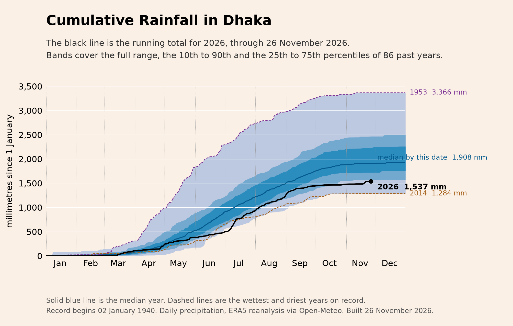

# Dhaka Weather

Automated Tufte-style weather graphs for Dhaka, Bangladesh, built in Python with
matplotlib and refreshed daily by GitHub Actions.

This is a Python port of [jdjohn215/milwaukee-weather](https://github.com/jdjohn215/milwaukee-weather),
adapted for a monsoon climate. The original uses R, ggplot2 and NOAA's GHCN-Daily
station records. This version uses ERA5 reanalysis served by Open-Meteo, which has
no station gaps over Bangladesh and reaches back to 1940.




*The two images above fill in after the first fetch-and-build run, whether you run
it locally or trigger the workflow from the Actions tab.*

## What the graphs show

**Daily high temperature.** Nested ribbons give the distribution of the daily
maximum temperature for every calendar day across the whole record, from the
all-time range down to the 40th to 60th percentile core. The black line is the
current year. Red and blue dots mark days where the current year broke the
all-time record for that calendar day, judged against the unsmoothed daily
extremes.

**Cumulative rainfall.** Dhaka receives most of its rain in a few monsoon months,
so a running annual total says far more than daily bars. Bands cover the full
historical range plus the 10th to 90th and 25th to 75th percentiles. The wettest
and driest years on record are traced as dashed lines, and the current year is
labelled against the median for the same date.

## About the data

[Open-Meteo](https://open-meteo.com/) serves ECMWF ERA5 and ERA5-Land reanalysis
as a free API with no key required. Two endpoints are used together.

| Endpoint | Role |
| --- | --- |
| `archive-api.open-meteo.com/v1/archive` | daily values from 1940 to roughly five days ago |
| `api.open-meteo.com/v1/forecast` with `past_days` | patches the reanalysis lag so the series runs to yesterday |

Variables pulled are `temperature_2m_max`, `temperature_2m_min` and
`precipitation_sum`, all in metric units, with the day boundary set to
`Asia/Dhaka`.

Reanalysis is a model-plus-observations product rather than a gauge reading at a
single point. For Dhaka that is a feature, since the local gauge record in
GHCN-Daily is patchy. If you want the station record instead, see the note on
swapping sources below.

**Citation.** Hersbach, H. et al. (2020), The ERA5 global reanalysis.
*Quarterly Journal of the Royal Meteorological Society*, 146, 1999 to 2049.
Open-Meteo asks that you credit them and link back when you publish a graph.

## Running it yourself

```bash
pip install -r requirements.txt

python src/fetch_dhaka.py                 # writes data/dhaka_daily.csv
python src/build_daily_high.py            # writes graphs/DailyHighTemp_Dhaka.png
python src/build_cumulative_precip.py     # writes graphs/CumulativeRainfall_Dhaka.png
```

The first fetch pulls the whole record from 1940 in twenty-year chunks and takes
a minute or two. Later runs refetch only a trailing window and merge, because
ERA5 revises its most recent days as the reanalysis settles. Pass `--full` to
force a complete refetch.

Useful flags.

```bash
python src/build_daily_high.py --smooth 1        # raw daily percentiles, no smoothing
python src/build_daily_high.py --smooth 11       # heavier smoothing of the ribbons
python src/build_daily_high.py --data path.csv --out somewhere.png
```

### No network access

`tools/make_sample_data.py` writes a synthetic Dhaka-like series so the plotting
code can be exercised offline. It is not real weather data.

```bash
python tools/make_sample_data.py --out data/sample_dhaka_daily.csv
python src/build_daily_high.py --data data/sample_dhaka_daily.csv --out graphs/_preview.png
```

## Automatic updating

`.github/workflows/update-graphs.yml` runs every day at 02:15 UTC, which is 08:15
in Dhaka. It refetches the data, rebuilds both graphs and commits the result back
to the repository. You can also trigger it by hand from the Actions tab.

Two settings matter on a fresh fork. Under Settings, Actions, General, set
workflow permissions to read and write, otherwise the commit step cannot push.
And GitHub disables scheduled workflows on repositories with no activity for
sixty days, so a run by hand wakes it up again.

## Adapting this to another city

Everything location-specific sits at the top of `src/fetch_dhaka.py`.

```python
LATITUDE = 23.8103
LONGITUDE = 90.4125
TIMEZONE = "Asia/Dhaka"
LOCATION_NAME = "Dhaka"
```

Change those four values, update `TITLE` in each build script, and the rest
follows. The rainfall y-axis step switches between 250 mm and 500 mm on its own
depending on how wet the place is.

To use a NOAA GHCN-Daily station instead, find the station code in
[ghcnd-stations.txt](https://www1.ncdc.noaa.gov/pub/data/ghcn/daily/ghcnd-stations.txt)
and read `https://www.ncei.noaa.gov/pub/data/ghcn/daily/by_station/<CODE>.csv.gz`
into the same column layout that `src/fetch_dhaka.py` writes, which is
`date, year, month, day, day_of_year, tmax_c, tmin_c, prcp_mm`. GHCN values
arrive in tenths of a degree Celsius and tenths of a millimetre, so divide both
by ten. Nothing downstream needs to change. The Dhaka station code is
`BGM00041923`.

## Figure settings

`src/style.py` holds the shared matplotlib configuration. Output is 300 dpi on a
170 mm canvas, Arial with TrueType font embedding (`pdf.fonttype` and
`ps.fonttype` set to 42), saved without `bbox_inches="tight"` so the declared
canvas size is exact. Change the canvas in one place and both graphs follow.

## Layout

```
.
├── src/
│   ├── style.py                      shared matplotlib configuration
│   ├── fetch_dhaka.py                data retrieval and incremental caching
│   ├── build_daily_high.py           temperature ribbon graph
│   └── build_cumulative_precip.py    cumulative rainfall graph
├── tools/
│   └── make_sample_data.py           synthetic series for offline testing
├── data/                             dhaka_daily.csv, written by the fetch script
├── graphs/                           generated PNGs
└── .github/workflows/
    └── update-graphs.yml             daily refresh
```

## Credit

Graph concept by [Edward Tufte](https://www.edwardtufte.com/bboard/q-and-a-fetch-msg?msg_id=00014g).
R implementation and automation pattern by [John D. Johnson](https://github.com/jdjohn215/milwaukee-weather).
Weather data by [Open-Meteo](https://open-meteo.com/), derived from ECMWF ERA5.
